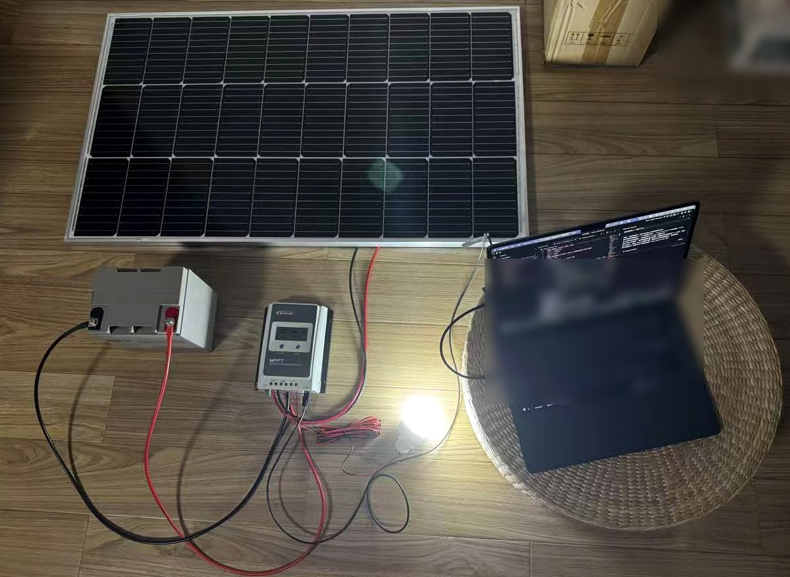
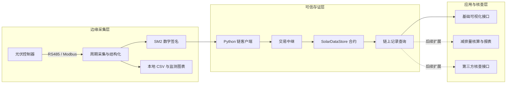
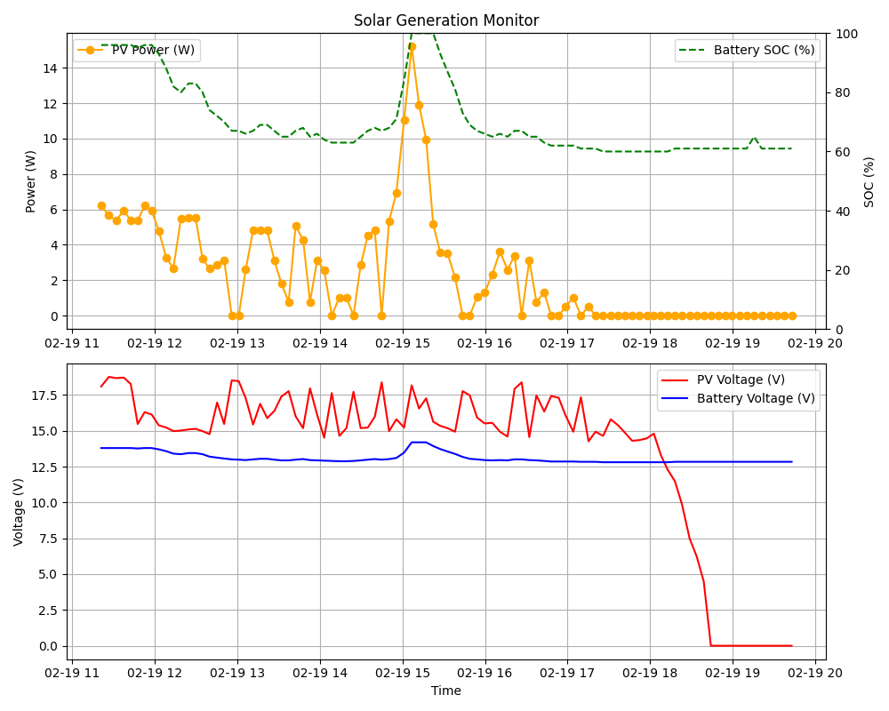

# SolarMRV

### 分布式光伏可信数据与 MRV 基础设施

**以真实设备数据为起点，连接物理采集、国密签名、联盟链存证与碳数据复核。**

SolarMRV 聚焦分布式光伏运行数据的来源证明、过程留痕和独立复核，为减排量核算、ESG 环境信息披露和能源管理提供设备级数据基础。项目围绕 IoT、国密密码学与 FISCO-BCOS 联盟链组织技术架构，将物理设备产生的运行指标转化为具有来源线索、时间信息和签名记录的数据证据。

当前已形成光伏控制器采集、SM2 数字签名、数据上链、历史查询、自动监测与可视化的原型链路，并保留连续运行数据和实验图表。MRV 核算与第三方核查是这一数据底座的延伸方向，正在围绕核算参数版本、签名复核和接口化交付继续完善。

[实验数据](data/solar_data_20260219_1121.csv) · [采集与签名](solar_monitor.py) · [数据合约](contracts/SolarDataStore.sol) · [技术路线](docs/roadmap.md) · [项目简介 PDF](docs/SolarMRV项目介绍.pdf)

## 硬件实验现场



实验装置包括太阳能光伏板、MPPT 控制器、蓄电池、灯泡负载与采集终端。控制器通过 RS485 / Modbus 提供物理指标，采集程序完成记录、签名与链上同步联调。

## 项目解决的问题

分布式光伏数据分散在控制器、运维系统和人工台账中。单份截图或汇总表通常无法完整说明数据由什么设备产生、何时采集、经历了哪些处理，以及后续记录是否与采集时一致。进入环境信息披露和碳数据核查流程后，这些问题会直接转化为补充材料、人工比对与重复核实的工作量。

SolarMRV 将数据证据的建立前移至设备采集环节：通过标准工业协议读取物理指标，在边缘端签名，再将关键记录写入联盟链，使后续应用能够沿着原始记录、签名和上链信息追溯数据处理过程。

项目的技术重点包括：

- **设备级溯源**：将光伏控制器与数字记录关联，保留发电功率、累计电量、电压及设备状态等指标。
- **采集后完整性保护**：以 SM2 数字签名记录数据内容，为识别传输和保存后的改动提供基础。
- **存证与查询**：将关键指标与签名写入 FISCO-BCOS，提供历史记录、最新记录和记录数量查询。
- **核查导向的数据组织**：围绕后续复核所需的设备身份、采集时间、参数版本与计算过程扩展数据结构。

## 技术架构

系统按边缘采集、可信存证和 MRV 应用三个层次组织。当前代码主要覆盖前两层及基础看板接口，核算引擎与专用核查接口为后续扩展模块。



### 设备直采与自动监测

采集端基于 `pymodbus` 读取光伏控制器的 Modbus 寄存器，支持光伏电压、电流、功率、蓄电池电压、SOC 和累计发电量等指标。程序提供真实设备模式与模拟模式，便于分别开展硬件联调和离线流程演示。

自动监测程序按配置周期执行采样，保存 CSV、生成运行图表，并提供 Telegram 状态通知与异常提醒。数据采集和链上同步分别处理，链连接异常时仍可保留本地监测记录。

### 国密签名与数据封装

签名模块使用 `gmssl` 实现 SM2 签名，按固定字段排序和 JSON 序列化规则组织待签名内容。采集工具可以输出包含设备标识、采集时间、运行指标、签名和公钥的结构化数据包。

当前自动监测上传路径保存的是部分物理指标及签名。完整签名原文、采集时间与公钥版本的持久化，以及与链上记录对应的独立验签流程，是后续完善的重点。

### 联盟链存证与记录查询

链客户端采用 JSON-RPC 读取与交易中继写入的双通道设计。`SolarDataStore.sol` 保存功率、电压、SOC、累计电量、签名、上链时间及上传者地址，支持以下接口：

| 接口 | 功能 |
|---|---|
| `storeData(...)` | 写入一条设备运行记录及签名 |
| `getData(id)` | 按记录编号查询 |
| `getLatestData()` | 获取最新记录 |
| `getDataCount()` | 获取记录总数 |

当前合约负责记录保存，签名字符串随记录一并留存；设备签名验证流程仍需补齐。采集时间和区块写入时间将在后续数据结构中分别保存，以支持对采集、传输与入链过程的独立分析。

### MRV 核算与第三方复核

MRV 扩展围绕“原始数据可追溯、计算过程可复算、核查行为可留痕”设计：

- 将发电增量、适用排放因子和核算规则关联，保存方法与参数版本。
- 在核算结果中记录源数据引用、计算时间与数据处理过程。
- 面向设备、项目与时间区间提供原始记录、签名状态及核算明细查询。
- 以访问权限和审计日志支持不同使用方的复核流程。
- 输出结构化记录及 PDF、Excel、JSON 报表，衔接数据分析与核查工作。

这些模块属于开发方向。具体核算规则与使用场景分别适配，设备采集数据、核算结果与外部审定结果采用独立状态管理。

## 实验验证

项目保留多轮设备采集样本。其中，2026 年 2 月 19 日的连续监测记录包含 **96 个采样点**，首末记录时间为 **11:21:14 至 19:42:45**，覆盖约 **8 小时 22 分钟**。采样周期配置为 5 分钟，实际间隔包含读取、落盘与同步处理时间。

| 验证项 | 仓库中的依据 |
|---|---|
| 连续采集记录 | 96 行设备运行数据，包含时间与主要物理指标 |
| 原始运行曲线 | 发电功率、光伏电压、SOC 与蓄电池电压监测图 |
| 签名实现 | SM2 / SM3 签名代码与结构化数据包生成逻辑 |
| 上链流程 | 链客户端、交易中继、数据存证合约及联调脚本 |



[查看原始 CSV](data/solar_data_20260219_1121.csv) · [查看监测程序](auto_monitor.py) · [查看链客户端](chain_client.py)

这组数据用于展示连续采集与运行特征。逐笔上链结果和独立验签结论还需配套交易回执、完整签名原文及验证记录，后续将按可复核实验的方式继续补充。

## ESG 应用与场景价值

### ESG 环境指标的源头存证

光伏采集与存证方案已被纳入 ESG 评级项目的环境维度技术设计，用设备侧连续记录补充企业自报数据，为发电量、能源使用和设备运行等指标提供更细粒度的原始凭证。该方案可进一步关联指标计算、数据版本和报告生成过程，支持从评价结果回溯到原始记录。

### 分布式光伏与能源管理

面向园区、工商业屋顶和分布式能源管理场景，保存发电设施的连续运行记录，为运行趋势分析、数据交接和异常追踪提供统一的数据入口。

### 碳数据核算与第三方复核

面向减排项目的数据准备、核算复算与第三方核查需求，探索设备记录、参数版本和计算结果之间的映射关系，减少分散材料的人工整理与重复比对。

签名与存证保护的是记录的来源关联和采集后完整性；设备计量准确性、运行边界与指标适用性仍需要相应的校验和核查依据。

## 当前实现与技术演进

| 方向 | 已有基础 | 进一步完善 |
|---|---|---|
| 设备采集 | Modbus 读取、周期监测、本地记录 | 设备身份管理、多协议接入、异常数据标识 |
| 签名链路 | SM2 签名、数据包封装 | 完整签名原文保存、公钥版本与独立验签 |
| 链上存证 | 数据合约、写入中继、历史查询 | 数据包关联、采集时间、重复记录检查 |
| 运行展示 | 监测图表、基础看板 API、历史看板原型 | 核查视角、真实与演示数据状态区分 |
| MRV 应用 | 业务流程与模块设计 | 核算引擎、因子与方法版本、报表及核查接口 |
| 系统部署 | 云端部署与运行验证经验 | 多节点联调、持久化与可复现实验环境 |

历史云端展示环境已归档，当前以仓库中的代码、数据和图表作为公开技术材料。

## 技术栈与代码导航

| 模块 | 技术 | 主要文件 |
|---|---|---|
| 设备采集与签名 | Python、pymodbus、pyserial、gmssl | [`solar_monitor.py`](solar_monitor.py) |
| 自动监测与图表 | pandas、Matplotlib | [`auto_monitor.py`](auto_monitor.py) |
| 联盟链读写 | FISCO-BCOS、JSON-RPC、HTTP 中继 | [`chain_client.py`](chain_client.py)、[`chain_relay_v2.py`](chain_relay_v2.py) |
| 数据存证 | Solidity | [`SolarDataStore.sol`](contracts/SolarDataStore.sol) |
| 看板后端 | Flask、Flask-CORS | [`api/app.py`](api/app.py) |
| 运行通知 | Telegram Bot API | [`telegram_notify.py`](telegram_notify.py) |
| 环境与配置 | 环境变量 | [`config.py`](config.py)、[`.env.example`](.env.example) |
| 联调与运维 | Python、Shell | [`tests/`](tests/)、[`scripts/`](scripts/) |

## 运行与复现

### 准备环境

```bash
python3 -m venv .venv
source .venv/bin/activate
pip install -r requirements.txt
cp .env.example .env
```

在 `.env` 中配置单独生成的 SM2 密钥对。真实设备采集还需要配置串口，链上联调需要自行部署 FISCO-BCOS 节点及交易中继，并填写相应连接参数。

将配置导入当前进程环境：

```bash
set -a
source .env
set +a
```

### 离线采集与签名演示

```bash
python solar_monitor.py --simulate
```

该命令使用模拟物理指标生成签名数据包，不会自动写入区块链。模拟输出与真实设备实验数据分别使用。

### 真实设备监测

连接控制器后，确认 `config.py` 中的串口、采样间隔等配置，再运行：

```bash
python auto_monitor.py
```

如直接运行 `solar_monitor.py` 读取真实设备，还需检查其命令行入口中的 `PORT` 配置。上链与通知功能分别依赖对应服务，运行前按实际环境配置。

### 联调说明

`tests/` 包含硬件与远程链节点联调脚本，部分脚本会写入链上数据或发送运行通知。具体用途见 [`tests/README.md`](tests/README.md)。看板 API 含演示回退逻辑，使用时应核对数据来源。

## 项目资料

- [连续监测数据](data/)与[运行图表](charts/)
- [技术路线与模块状态](docs/roadmap.md)
- [项目简介 PDF](docs/SolarMRV项目介绍.pdf)
- [辅助脚本说明](scripts/README.md)
- [安全说明](SECURITY.md)

技术状态以本页、技术路线和对应源代码为准。

## 开源与交流

代码采用 [MIT License](LICENSE)。技术交流、设备适配和应用合作可通过 [GitHub Issues](https://github.com/Pluvio-Han/SolarMRV/issues) 联系。
